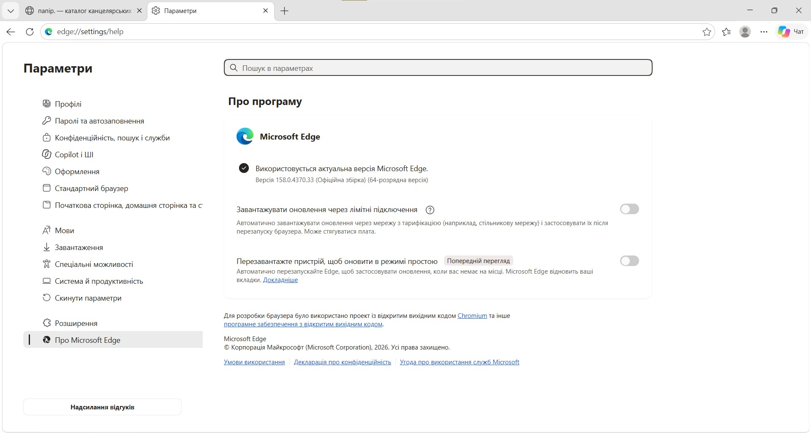
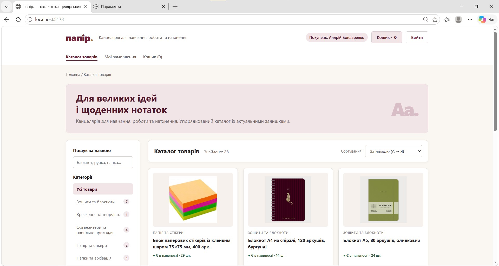
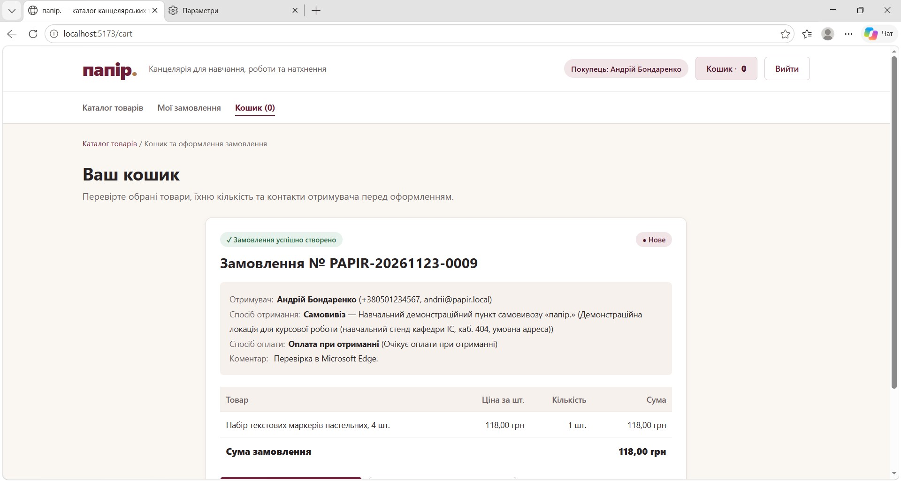
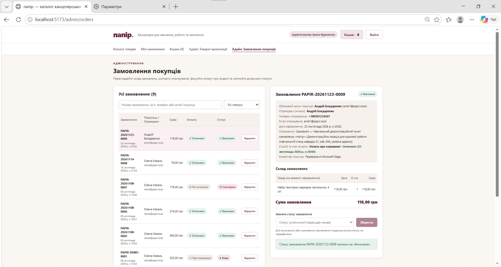
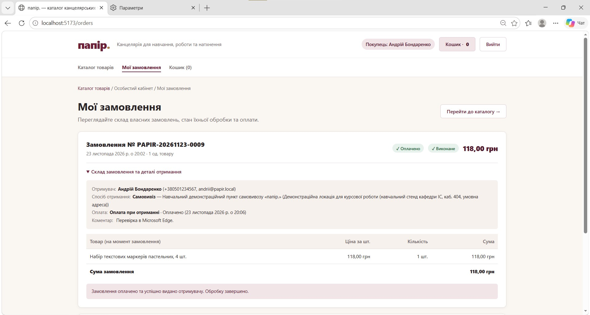
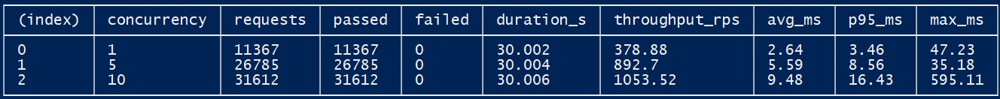

# Додаткові перевірки вебзастосунку «папір.»

Дата виконання: 23.11.2026.

Перевірено основний сценарій в Microsoft Edge та роботу API каталогу під паралельним навантаженням.

## 1. Середовище

| Параметр | Значення |
|---|---|
| Операційна система | Windows 10 |
| Процесор | Intel Core i5-7300U, 2,60 ГГц |
| Фізичні ядра / логічні процесори | 2 / 4 |
| Оперативна пам’ять | Приблизно 8 ГБ; зафіксовано 7,9 ГіБ |
| Браузер додаткової перевірки | Microsoft Edge 158.0.4370.33, 64-bit |
| Node.js для генератора навантаження | v24.15.0 |
| Інтерфейс | http://localhost:5173 |
| Сервер | http://localhost:5150 |

Клієнт, сервер, база даних і генератор навантаження працювали на одному комп’ютері. Запити надсилалися через localhost.

## 2. Перевірка основного сценарію в Microsoft Edge

Виконано такі дії:

1. Відкрито каталог і перевірено відображення товарів та зображень.
2. Виконано вхід покупцем Андрієм Бондаренком.
3. Додано товар до кошика та оформлено замовлення.
4. Виконано вхід адміністратором.
5. Замовлення переведено у статус «В обробці».
6. Зафіксовано оплату при отриманні.
7. Замовлення переведено у статус «Виконане».
8. Виконано повторний вхід покупцем і перевірено збереження результату після оновлення сторінки.

Контрольне замовлення:

| Поле | Значення |
|---|---|
| Номер | PAPIR-20261123-0009 |
| Товар | Набір текстових маркерів пастельних, 4 шт. |
| Кількість | 1 |
| Сума | 118,00 грн |
| Отримання | Самовивіз |
| Оплата | При отриманні |
| Коментар | Перевірка в Microsoft Edge. |
| Кінцевий статус | Виконане |
| Кінцевий стан оплати | Оплачено |

Основний сценарій завершився успішно. Оплата та кінцевий статус відображаються як адміністратору, так і покупцеві після повторного входу й оновлення сторінки.

### Докази











Перевірка стосується наведеного сценарію та зазначеної версії Edge. Вона не означає перевірки всіх функцій у всіх браузерах.

## 3. Методика навантажувального тесту

Перевірявся маршрут:

```text
GET http://localhost:5150/api/products
```

Генератор реалізовано у файлі:

`verification/load-test-duration.cjs`

Використано Node.js та вбудовану функцію fetch.

Перед вимірюваннями виконано один контрольний запит і п’ять запитів прогрівання. Вони не включені до підсумкової кількості вимірюваних запитів.

Послідовно виконано три етапи:

- один потік запитів протягом 30 секунд;
- п’ять паралельних потоків протягом 30 секунд;
- десять паралельних потоків протягом 30 секунд.

Кожен потік надсилає наступний запит після завершення попереднього. Окрема пауза між запитами не задається.

Після завершення 30 секунд нові запити не створюються, а вже надіслані очікуються до завершення. Тайм-аут одного запиту становить 10 секунд.

Успішним вважається запит зі статусом HTTP 200, відповідь якого вдалося прочитати як JSON. Зміст кожної відповіді не перевірявся на повну бізнес-коректність.

Вимірювався час від початку fetch до завершення читання та розбору JSON. Це клієнтський час запиту, а не окремий час виконання SQL або серверного методу.

Тест виконує лише читання каталогу та не створює замовлень і не змінює залишків.

## 4. Результати навантажувального тесту

Початок: 23.11.2026 о 20:17:47 за київським часом.

Завершення: 23.11.2026 о 20:19:18 за київським часом.

| Паралельність | Запитів | Успішних | Помилок | Тривалість, с | Запитів/с |
|---:|---:|---:|---:|---:|---:|
| 1 | 11 367 | 11 367 | 0 | 30,002 | 378,88 |
| 5 | 26 785 | 26 785 | 0 | 30,004 | 892,70 |
| 10 | 31 612 | 31 612 | 0 | 30,006 | 1 053,52 |

| Паралельність | Середній час, мс | p95, мс | Максимальний час, мс |
|---:|---:|---:|---:|
| 1 | 2,64 | 3,46 | 47,23 |
| 5 | 5,59 | 8,56 | 35,18 |
| 10 | 9,48 | 16,43 | 595,11 |

p95 – значення часу, яке не перевищили 95% виміряних запитів відповідного етапу.

Загалом виконано 69 764 вимірювані запити. Усі отримали HTTP 200 і завершилися успішним розбором JSON. Зафіксованих помилок немає.

Зі збільшенням паралельності зросли кількість оброблених запитів за секунду та середній час відповіді. Найбільший окремий час становив 595,11 мс на етапі з десятьма паралельними потоками.



## 5. Файли результатів

| Файл | Вміст |
|---|---|
| [load-test-duration.cjs](verification/load-test-duration.cjs) | Код генератора навантаження |
| [results.json](verification/results.json) | Параметри середовища, підсумки та результати окремих запитів |
| [requests.csv](verification/requests.csv) | Детальні результати запитів у табличному форматі |

Для повторення тесту потрібно запустити сервер застосунку, відкрити PowerShell у папці Project і виконати:

```powershell
node .\documentation\verification\load-test-duration.cjs
```

Генератор створює нову папку результатів у поточному робочому каталозі. Фактичні показники повторного прогону можуть відрізнятися.

## 6. Висновок та обмеження

Основний сценарій оформлення, адміністративної обробки, оплати й завершення замовлення успішно виконано в Microsoft Edge.

У навантажувальному тесті API каталогу обробив усі запити без зафіксованих помилок на перевірених рівнях паралельності.

Висновки обмежені умовами прогону:

- перевірено один маршрут читання каталогу;
- використано наявний невеликий робочий каталог;
- кожен рівень навантаження перевірено одним прогоном тривалістю приблизно 30 секунд;
- генератор і застосунок працювали на одному комп’ютері;
- затримки зовнішньої мережі не моделювалися;
- навантаження на оформлення замовлень і завантаження зображень не перевірялося;
- використання процесора й пам’яті під час прогону окремо не вимірювалося;
- тривала стабільність і гранична продуктивність не визначалися.